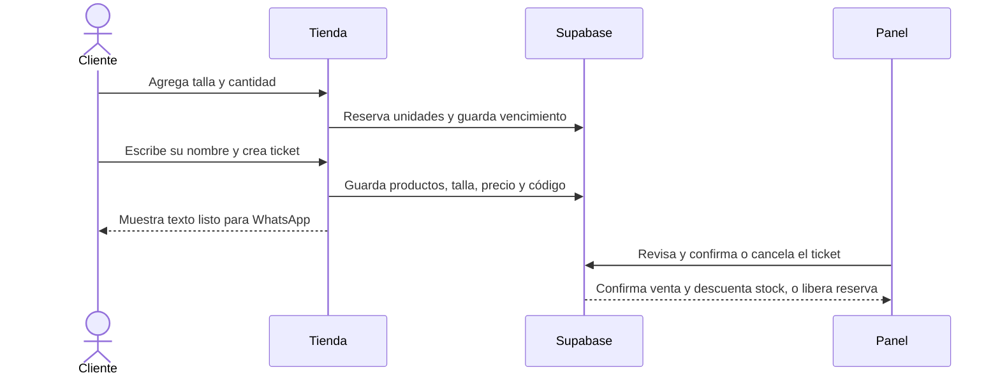

# PRD: carrito reservado, equipo y promociones

## Objetivo y decisiones confirmadas

Una persona puede consultar sin cuenta, reservar unidades por talla durante dos horas desde su último cambio, y pedir atención por WhatsApp mediante un ticket con código. No se cobra en línea ni se manda WhatsApp automáticamente.

- Inventario inicial: cero unidades por talla; el equipo carga las cantidades reales antes de vender.
- Una reserva vence dos horas después del último cambio y deja de descontar inventario automáticamente.
- El ticket conserva la reserva dos horas. Solo un administrador confirma la venta y descuenta las unidades definitivamente; cancelar o vencer libera la reserva.
- Checkout pide solo el nombre y autorización de tratamiento de datos; el usuario decide si envía el texto prellenado por WhatsApp.
- Promociones: descuento porcentual aplicado a productos seleccionados dentro de una fecha de inicio y cierre. No se acumulan; si hay más de una activa, se aplica el mayor descuento.
- El panel permite crear, editar, pausar y eliminar promociones/descuentos; no programa publicaciones de redes sociales.
- Administrador: gestiona productos, precios, fotos, existencias, promociones, ajustes y accesos del equipo. Operario: gestiona existencias, pedidos y tickets; no puede confirmar ventas ni cambiar precios.

## Recorrido

## Criterios de aceptación

1. La base calcula disponibilidad transaccionalmente y evita reservar una misma última unidad dos veces.
2. Cambiar una talla o cantidad reinicia las dos horas; vencimientos se aplican aunque el navegador esté cerrado.
3. El panel permite registrar unidades por talla y conserva historial con usuario y hora.
4. Cada ticket guarda nombre, líneas, talla, cantidad, precio cotizado, estado y expiración; el código es único.
5. WhatsApp abre un texto que el cliente envía manualmente. No se realiza pago ni envío automático.
6. Solo administrador confirma la venta; operario puede cancelar tickets y actualizar estados de pedidos.
7. Los descuentos muestran precio regular y precio promocional; el servidor cotiza el mismo valor que ve el cliente.
8. Roles se validan en base de datos/servidor. La clave privada requerida por la API de invitaciones nunca llega al navegador.

## Estado actual

- Código de estas funciones está publicado en `main` (commit `c6e0daa`). GitHub reportó el despliegue Vercel como completado.
- **Base de producción actualizada:** migraciones `20261109174615_inventory_carts_staff_promotions` y `20261109174813_restrict_staff_functions_and_index_foreign_keys` aplicadas al proyecto Supabase del negocio. Hay 15 variantes de talla creadas con inventario total en cero; faltan las cantidades reales.
- El usuario indica que agregó `SUPABASE_SECRET_KEY` en Vercel. No pudimos leer ni confirmar el valor desde la integración disponible, que está conectada a otra cuenta; no se intentó recuperar el secreto.
- La única base del proyecto sigue siendo Supabase `uymvinfxlwqzzwyditsv` (`us-west-2`); ya tiene productos y categorías, pero no cantidades reales por talla.
- Correo confirmado para el primer administrador: `elbanquillodepablo@gmail.com`; figura en `admin_emails`, pero aún no existe un usuario en `admins`. Invitar desde Supabase Auth; al aceptar, el trigger concede el rol inicial. No guardar contraseñas en el repositorio ni en documentación.
- Inicialmente los usuarios internos tienen dos roles: `admin` y `operario`. Cualquier admin activo puede invitar y desactivar ambos roles; la API evita desactivar al último admin activo.
- Promociones se activan según sus fechas; no hay integración para publicar contenido en redes sociales.

## Fuera de alcance

- Cuenta obligatoria para clientes, pagos en línea, automatización de WhatsApp o publicación en redes.
- Tarifas de personalización de camisetas; se siguen confirmando por WhatsApp como hoy.

## Horarios y refinamiento visual (2026-11-09)

El administrador puede configurar días y una franja diaria de atención en Ajustes. Durante la atención las reservas duran dos horas; fuera del horario configurado vencen dos horas después de la siguiente apertura. La regla está desactivada hasta que el administrador confirme el horario real. Las reservas existentes conservan su vencimiento hasta que se modifiquen. Horario visible opcional e independiente. Migración business_reservations aplicada.

Se refinó la legibilidad del logo, la tipografía del inicio, el ritmo de texto y el movimiento reducido. El pie incluye Creado por Zenubit. Compilación y detector Impeccable correctos; revisión visual en navegador pendiente.

## Primer acceso corregido

Cuenta inicial comprobada: correo confirmado, rol admin activo. La aplicación dispone de /admin/activar para definir contraseña con sesión de invitación o recuperación. El login permite solicitar recuperación. Supabase Auth debe usar Site URL https://elbanquillodepablo.vercel.app y permitir https://elbanquillodepablo.vercel.app/admin/activar como Redirect URL. Esta configuración del proveedor sigue pendiente de guardar por el propietario; el código no puede sustituirla.

## Portada, fotos y seguridad — 2026-11-09

- Corregido el error público del catálogo: políticas de lectura separadas para visitantes, sin concederles ejecución de funciones administrativas. Migración storefront_access_and_campaign aplicada a la única base del proyecto.
- Ajustes > Portada: destacados, nuevas referencias o descuentos vigentes; camiseta principal opcional y texto del botón. Título/subtítulo siguen siendo editables. Selecciones vacías muestran un mensaje honesto.
- Ingresar visible en escritorio y móvil; Mi panel cuando existe rol activo. Usuarios internos conservan los permisos en base y servidor.
- Nuevo símbolo de tres asientos, wordmark e iconos de aplicación. Color verde/lima conservado. Portada como cartel de la selección de Pablo; no se inventaron fotos ni descuentos. La base tiene tres productos y ninguna foto al verificar.
- Fotos nuevas: WebP/JPEG con presupuesto objetivo 350 KiB + miniatura 80 KiB; reducción de calidad y dimensiones, máximo de entrada 25 MiB/48 MP, SVG/GIF rechazados, recodificación sin metadatos. Tarjetas usan miniatura; detalle usa imagen grande. No reoptimiza archivos antiguos.
- Una sola consulta de productos en inicio; precios ordenados después de aplicar descuentos. Fecha de vencimiento incluye el día para reservas nocturnas.
- React Router 7.18.5 y Vite 6.4.5: npm audit sin vulnerabilidades conocidas. API antigua create_order retirada para clientes; JSON de gestión de equipo validado; destino de login limitado a rutas administrativas.
- Comprobaciones: compilación TypeScript y Vite, navegación pública y login, protección de /admin/ajustes, sin desbordamiento horizontal a 1440/768/390/320 px. Imagen sintética 12.0 MB -> 178282 bytes + 58474 bytes; sin subir datos de prueba. SQL con rol anon muestra catálogo y oculta admins/tickets; no puede confirmar ventas.
- No se probó guardar ajustes con una sesión real del propietario ni enviar invitaciones/correos. Usuario indica haber guardado las URL de Auth. Revisar docs/SEGURIDAD.md para límites y pendientes.

## Corrección del servicio de equipo (2026-11-09)
Las funciones api/admin/staff, robots, sitemap y product-meta usan ahora el export Web Standard de Vercel (objeto con fetch). Antes exportaban una función directa con firma Web Request, incompatible con la entrada Node req/res. Adaptadores Netlify conservan la función mediante .fetch. El panel trata respuestas no JSON sin mostrar errores de parsing. Pruebas locales: staff 401 sin sesión, 403 origen externo, 405 método inválido; robots 200. La prueba autenticada de invitación sigue pendiente; no se enviaron correos.

